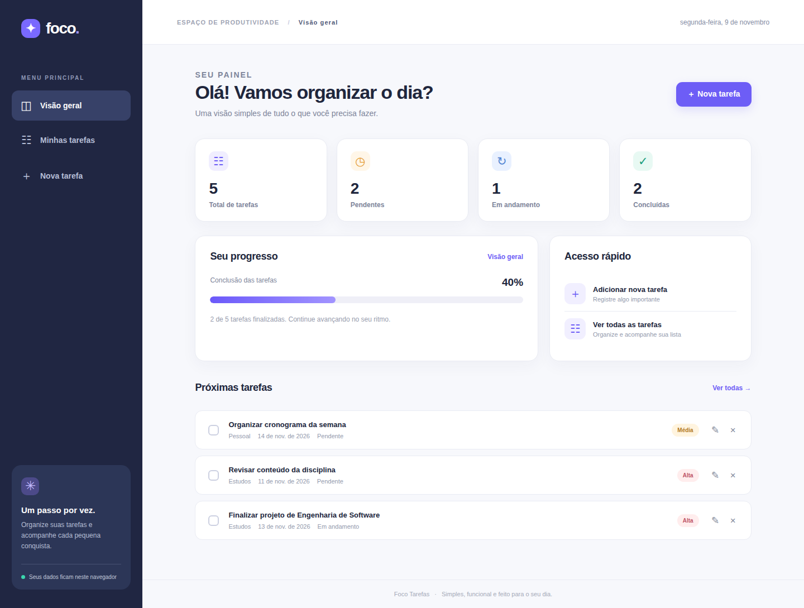
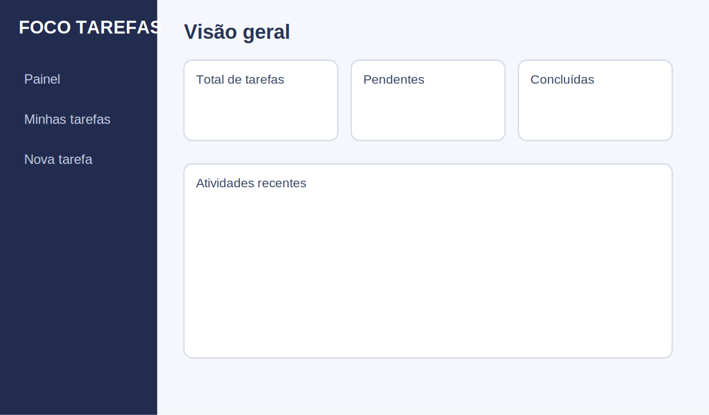
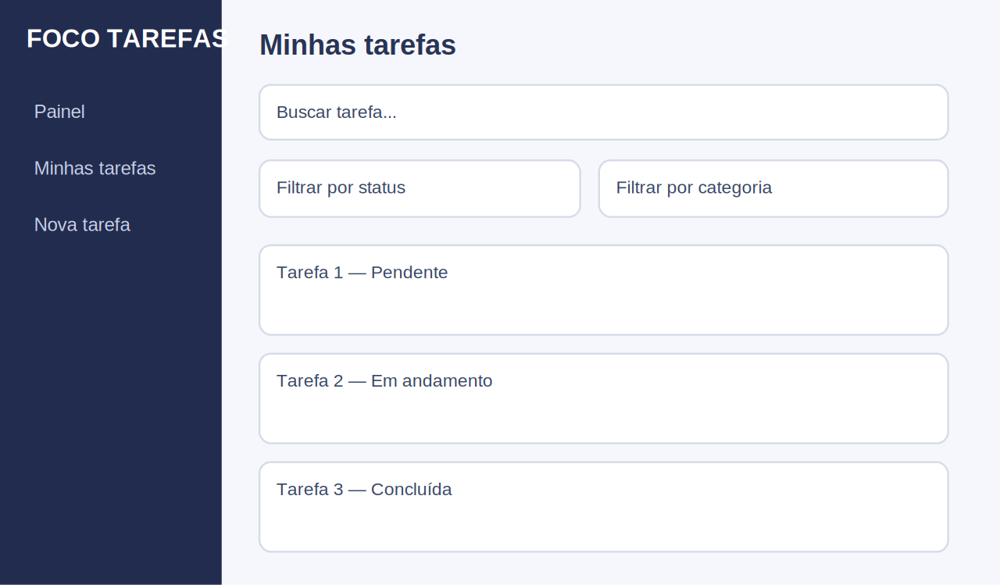
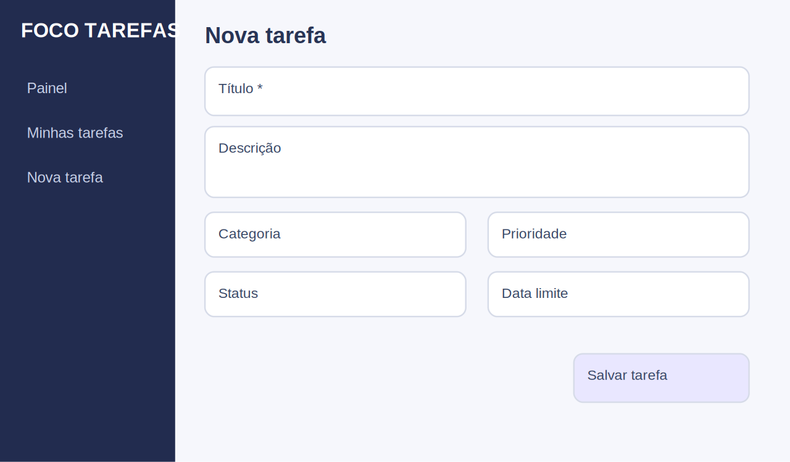
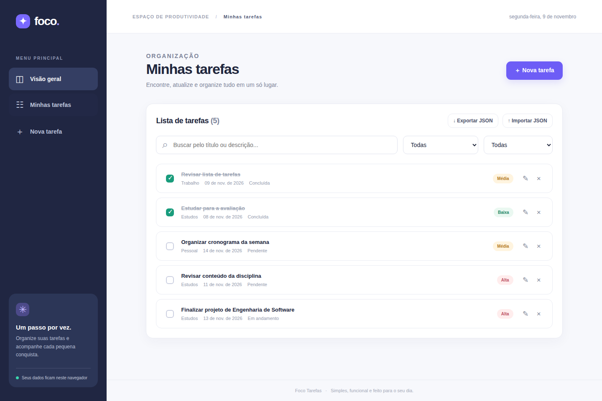
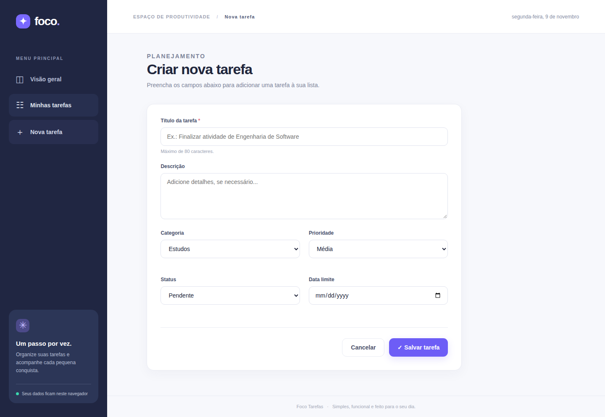
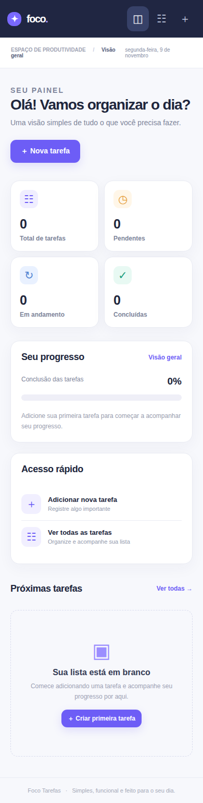
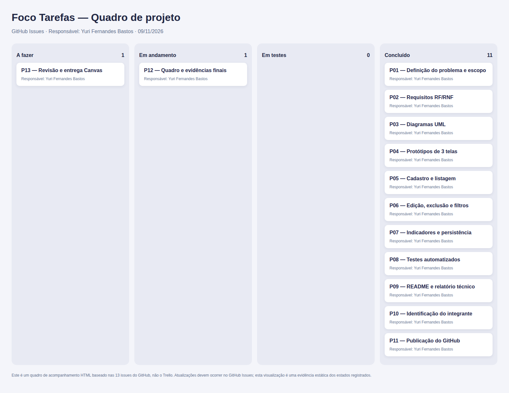

# Foco Tarefas — Projeto Final de Engenharia de Software



**Foco Tarefas** é um gerenciador de tarefas pessoais feito em HTML, CSS e JavaScript para o Projeto Final de Engenharia de Software da UNIMA (Maceió).

**Integrante único:** Yuri Fernandes Bastos  
**Prazo acadêmico:** 13 de novembro de 2026  
**Gerenciamento:** [Trello — quadro com 4 colunas](https://trello.com/b/JDK4XMEM/foco-tarefas-engenharia-de-software) e [GitHub Issues](https://github.com/bastoss-dev/university-homework/issues?q=is%3Aissue+%22Foco+Tarefas%22)  
**Relatório técnico:** [PDF completo com as dez seções exigidas](docs/relatorio-final.pdf)

## Problema, objetivo e público-alvo

Tarefas acadêmicas, profissionais e pessoais dispersas dificultam a organização. O aplicativo reúne pendências, permite priorizá-las e acompanhar o progresso. O usuário-alvo é qualquer pessoa que precise administrar tarefas individuais. Não há contas, sincronização na nuvem ou avisos automáticos.

## Como executar o software

**Não requer instalação, servidor, banco de dados nem internet.**

1. Entre na pasta `foco-tarefas` do repositório.
2. Abra **[index.html](index.html)**, que contém todo o HTML, CSS e JavaScript em um único arquivo; ou **[index-modular.html](index-modular.html)**, mantendo também as pastas `css` e `js`.
3. Clique em **Nova tarefa**, preencha título, categoria, prioridade e outros dados.
4. Use **Minhas tarefas** para consultar, editar, excluir, filtrar e concluir.
5. Se quiser preservar dados antes de limpar o navegador, utilize **Exportar JSON**.

Os dados ficam no `localStorage` do navegador utilizado. Trocar de navegador ou limpar os dados pode apagar as tarefas daquela instalação local.

## Funcionalidades implementadas

| ID | Funcionalidade |
|---|---|
| RF01 | Cadastrar tarefas com título obrigatório |
| RF02 | Consultar e listar tarefas |
| RF03 | Editar tarefas |
| RF04 | Excluir tarefas com confirmação |
| RF05 | Alterar status ou marcar conclusão |
| RF06 | Buscar texto e filtrar por status/categoria |
| RF07 | Indicadores de pendências, andamento, conclusões e progresso |
| RF08 | Importar/exportar backup JSON |

Os requisitos não funcionais RNF01–RNF03 abrangem interface responsiva, execução local/persistência e validação de entrada.

## Tecnologias e estrutura

- **HTML5/CSS3:** interface, layout responsivo e acessibilidade básica.
- **JavaScript:** regras, CRUD, indicadores, importação/exportação e eventos.
- **localStorage:** persistência de dados no navegador.
- **Node.js, módulo node:test:** testes automatizados de regras (somente para desenvolvimento).
- **Python, Playwright, ReportLab e CairoSVG:** geração de capturas, UML e relatório.
- **GitHub Issues:** registro do planejamento com responsável individual e histórico.

```text
foco-tarefas/
├── index.html                       # Programa completo e independente
├── index-modular.html               # Mesmo programa, usando CSS e JS externos
├── css/styles.css
├── js/core.js                       # TaskManager, validação e persistência
├── js/app.js                        # Eventos e interface
├── tests/core.test.js               # 10 casos automatizados
├── dados-projeto.json
├── docs/
│   ├── relatorio-final.pdf
│   ├── requisitos.md
│   ├── testes.md
│   ├── resultado-testes-node.txt
│   ├── evidencias-testes-ui.txt
│   ├── uml/                         # Diagramas em SVG, PNG e fontes PUML
│   ├── prototipos/                  # Três telas em SVG e PNG
│   ├── capturas/                    # Capturas reais, quadro e versão mobile
│   └── planejamento/               # Quadro Markdown, HTML, CSV e instruções
└── scripts/
    ├── build_assets.py              # Capturas e PNG
    └── gerar_relatorio.py           # Relatório PDF
```

## Testes e validação

Execute a suíte de regras:

```bash
node --test tests/core.test.js
```

A suíte registra **10 casos de teste**, incluindo cadastro, filtro, edição, conclusão, exclusão, validação, importação/exportação e persistência.

As **12 verificações da interface** são executadas pelo script `scripts/build_assets.py` em Chromium, usando um servidor HTTP local e **localStorage real**, inclusive teste de persistência após recarregar. Os resultados estão em [evidencias-testes-ui.txt](docs/evidencias-testes-ui.txt). O [workflow do GitHub Actions](https://github.com/bastoss-dev/university-homework/actions/workflows/foco-tarefas-assets.yml) prepara os anexos e executa os testes.

## UML e prototipação

- **UML 1:** [Diagrama de casos de uso](docs/uml/casos-de-uso.png) ([fonte editável](docs/uml/casos-de-uso.puml)).
- **UML 2:** [Diagrama de classes](docs/uml/classes.png) ([fonte editável](docs/uml/classes.puml)).

| Protótipo 1 — Painel | Protótipo 2 — Lista | Protótipo 3 — Formulário |
|---|---|---|
|  |  |  |

## Capturas do software







As capturas de aplicação foram produzidas pelo próprio programa com tarefas fictícias em um navegador automatizado.

## Planejamento do projeto

Adotou-se o **modelo incremental**, com quatro incrementos: levantamento e planejamento; UML/protótipos; implementação; testes/documentação.

O gerenciamento usa **Trello** com 13 cartões distribuídos em quatro listas (A fazer, Em andamento, Em testes e Concluído), associado a **GitHub Issues** como histórico de apoio. Os cartões identificam Yuri Fernandes Bastos como responsável e apontam para os artefatos do projeto. Existem 12 atividades de preparação concluídas; resta a conferência final e o envio no Canvas.



O quadro HTML preserva o planejamento inicial; o **quadro Trello real** foi criado em 09/11/2026 e contém os cartões de acompanhamento.

## Relatório final e entrega

- **[Abrir relatório técnico PDF](docs/relatorio-final.pdf)**
- **[Abrir o quadro real no Trello](https://trello.com/b/JDK4XMEM/foco-tarefas-engenharia-de-software)**
- **[Ver atividades e responsáveis](https://github.com/bastoss-dev/university-homework/issues?q=is%3Aissue+%22Foco+Tarefas%22)**

O PDF apresenta identificação, introdução, planejamento, requisitos, UML, protótipos, desenvolvimento, testes, considerações finais e links.

**Etapa a cargo do aluno:** revisar os arquivos e o software no próprio computador, corrigir o que encontrar e enviar o PDF e os links pelo Canvas até 13/11/2026.

**Nota de transparência:** o código, os testes e a documentação foram preparados com assistência automatizada; a responsabilidade pelo conteúdo, pela conferência final e pela entrega é do integrante Yuri Fernandes Bastos.


**Quadro de acompanhamento real (Trello):** https://trello.com/b/JDK4XMEM/foco-tarefas-engenharia-de-software

O quadro foi criado como privado; para a avaliação, compartilhar com o professor ou ajustar a visibilidade antes da entrega.
